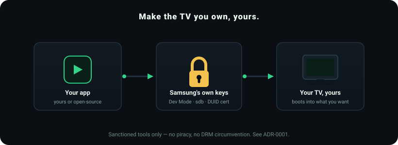

# Spudger

<p align="center">
  
</p>

> A spudger is the nylon pry tool every teardown uses to pop open a sealed
> device without cracking the case. This project does the software equivalent
> for a **Samsung Tizen TV**: it pries the set open — through Samsung's own
> sanctioned developer tools — so the owner can make it *theirs*.

Part of the **ry-ops** line-up (`ry-ops/spudger`) — tactile, craft-tool names.

## What this is

Tooling, findings, and runbooks for sideloading your own apps onto a Samsung
QLED TV (and, down the road, exploring deeper ownership of hardware you own).
The first payload is **VolumioTV** — a full-screen Volumio music front-end with
TV-remote media controls — running on a `QN43Q60DAFXZA` (Tizen 9).

Everything here uses tools Samsung *ships and documents*: Developer Mode, `sdb`
(Samsung Debug Bridge), Tizen Studio, Samsung-issued certificates bound to the
device's DUID, and Samsung's own [`tizen-agent-skills`](https://github.com/Samsung/tizen-agent-skills).

<p align="center">
  
</p>

**On ethics:** we do not condone piracy, DRM circumvention, or breaking into
devices you don't own. See [`docs/adr/0001-sanctioned-techniques-not-piracy.md`](docs/adr/0001-sanctioned-techniques-not-piracy.md).

## Layout

> **Device values stay private.** The real DUID, Wi-Fi MAC, and LAN IPs are not
> in this repo. They live in `device.local.env` (gitignored) — copy
> `device.example.env` and fill in your own. Likewise the app's Volumio URL lives
> in `VolumioTV/config.js` (gitignored) — copy `VolumioTV/config.example.js`. The
> docs and tools refer to these by name.

```
spudger/
├── README.md
├── RUNBOOK.md              # operational quick-reference (the final-mile sideload)
├── device.example.env      # TEMPLATE → copy to device.local.env (gitignored)
├── VolumioTV/              # the live app: index.html, config.xml, icon.png
│   └── config.example.js   # TEMPLATE → copy to config.js (gitignored)
├── tools/
│   ├── connect.sh          # cold-boot → plain sdb server → connect (the hard-won recipe)
│   ├── sideload.sh         # package → sign → install → launch
│   └── probe.py            # diagnose: is the TV's sdbd actually healthy?
└── docs/
    ├── INSTALL.md          # install everything this project needs
    ├── FINDINGS.md         # device facts, the access ceiling, the sdb root cause
    ├── ROADMAP.md          # where this is going
    └── adr/                # architecture / policy decision records
        └── 0001-sanctioned-techniques-not-piracy.md
```

## Tools

<p align="center">
  
</p>

- **`connect.sh`** — closes the IDE, starts a plain `sdb` server, and connects
  reliably (the `--only-detect-tizen` fix).
- **`sideload.sh`** — package → sign → install → launch.
- **`probe.py`** — raw sdb `CNXN` handshake to prove whether the TV's `sdbd` is
  healthy when the CLI won't connect.

## Quick start

1. Install the toolchain — see [`docs/INSTALL.md`](docs/INSTALL.md).
2. Set your device values:
   `cp device.example.env device.local.env` and
   `cp VolumioTV/config.example.js VolumioTV/config.js`, then edit both.
3. Put the TV in Developer Mode and connect — see [`RUNBOOK.md`](RUNBOOK.md)
   and run [`tools/connect.sh`](tools/connect.sh).
4. Sideload the app — [`tools/sideload.sh`](tools/sideload.sh).

## Status

- ✅ Dev Mode + `sdb` access working
- ✅ Samsung certificate signing working
- ✅ VolumioTV sideloaded and live (full-screen UI + remote media/volume/seek keys)
- 🔎 Evaluating Samsung's `tizen-agent-skills` as a maintained backbone
- ⏭️ Root / boot-into-app research (owner-choice; see ADR-0001)
